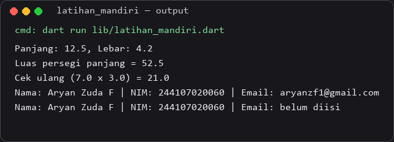
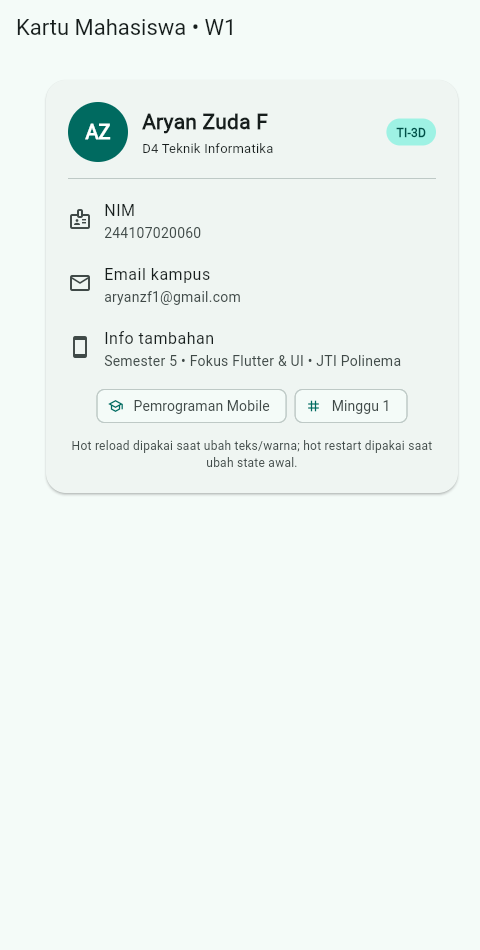
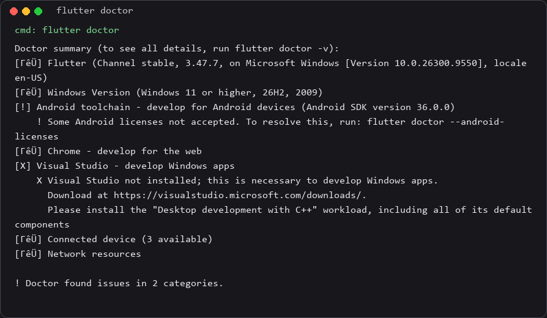
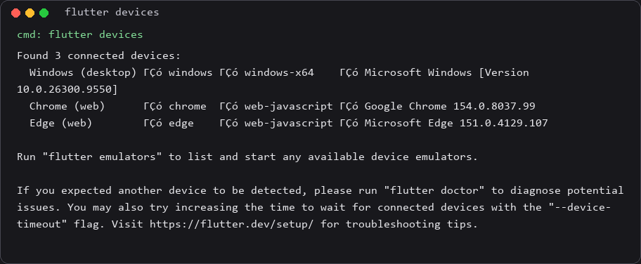
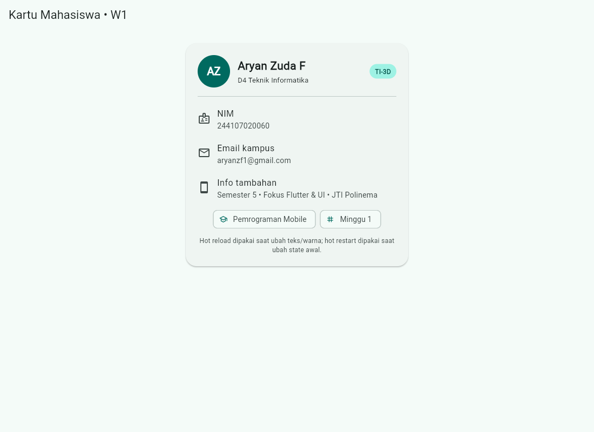

# 01 Week 1 Mobile Development Ecosystem & Flutter Refresh

Dokumentasi hasil pengerjaan Praktikum Pemrograman Mobile Minggu ke-1.
Dokumentasi ini telah berisi: screenshot, penjelasan, dan jawaban
pertanyaan dari praktikum.

Nama: Aryan Zuda F (NIM 244107020060, Kelas TI-3D)

## Latihan Mandiri

1. Buat fungsi `hitungLuasPersegiPanjang(double panjang, double lebar)`
   yang mengembalikan luas.
2. Buat kelas `Profil` dengan properti `nama`, `nim`, dan `email`
   (boleh null/empty).
3. Panggil keduanya dari `main()` dan tangani kondisi email kosong
   dengan aman (tanpa operator `!`, memakai `?.` dan nilai default).

Kode: [`my_first_app/lib/latihan_mandiri.dart`](my_first_app/lib/latihan_mandiri.dart)
(dijalankan dengan `dart run lib/latihan_mandiri.dart`).

Contoh yang saya pakai memakai angka sendiri: panjang 12.5 dan lebar 4.2
(menghasilkan 52.5) plus cek ulang 7.0 x 3.0. Method ringkasannya bernama
`ringkasan()` dengan fallback teks `belum diisi` untuk email kosong
atau hanya berisi spasi.



## Praktikum

Aplikasi kartu profil mahasiswa dengan desain kartu (avatar AZ, badge
TI-3D, ListTile NIM/email/info tambahan, dan chip), dijalankan di Chrome
viewport portrait mobile. Kode: [`my_first_app/lib/main.dart`](my_first_app/lib/main.dart).



## Checklist Verifikasi

- `flutter doctor` tidak memiliki masalah yang menghambat target web/Chrome.
  (Catatan: 2 issue tidak terkait target Chrome — lihat Kendala.)

  

- `flutter devices` mendeteksi target Chrome dan Edge.

  

- Aplikasi berjalan dan UI default telah diganti dengan kartu profil.

  

- Dapat menjelaskan perbedaan hot reload dan hot restart.

Penjelasan singkat:

```text
- Hot reload: mengubah tampilan tanpa mengulang aplikasi dari awal,
  state tetap terjaga. Enak untuk iterasi teks dan warna.
- Hot restart: mengulang aplikasi dari awal dan me-reset state.
  Dipakai bila perubahan menyentuh inisialisasi aplikasi.
```

- Repository berisi source code, README, screenshot, dan riwayat commit.

---

### Mini Assignment

Buat aplikasi Profil Mahasiswa berdasarkan praktikum. Tambahkan NIM dan satu
informasi tambahan (Semester 5, fokus Flutter & UI, JTI Polinema)
menggunakan widget dasar.



---

### Kendala Setup

- `flutter doctor`: lisensi Android belum diterima (`flutter doctor
  --android-licenses`) dan Visual Studio Build Tools belum terpasang.
  Keduanya tidak menghambat target Chrome/web yang dipakai untuk
  praktikum ini; Chrome dan Edge terdeteksi di `flutter devices`.
- Build web pertama cukup lama (kompilasi Dart ke JavaScript), jadi
  screenshot Chrome headless perlu jeda inisialisasi (virtual-time-budget)
  agar tampilan Flutter sudah tampil sebelum gambar diambil.

## Hot Reload vs Hot Restart

### Hot Reload

Hot reload itu menanamkan perubahan kode ke aplikasi yang sedang jalan
tanpa mengulang dari awal, jadi state terakhir tidak hilang. Saya pakai
ini saat mengganti tulisan nama, warna seed teal, dan susunan kartu
karena hasilnya langsung terlihat dalam hitungan detik.

### Hot Restart

Hot restart itu menghentikan aplikasi lalu menjalankannya lagi dari awal
sehingga seluruh state kembali ke kondisi awal. Prosesnya lebih lambat
dari hot reload, tapi wajib dipakai ketika perubahan ada di fungsi
`main()`, inisialisasi, atau saat state terlanjur rusak dan perlu
memastikan aplikasi benar-benar mulai bersih.

## Refleksi

### 1. Kapan native lebih tepat dipilih daripada cross-platform?

Native lebih tepat dipilih ketika aplikasinya menuntut akses API sistem
yang paling baru, latensi rendah (audio real-time, kamera), atau optimasi
performa per perangkat yang tidak bisa ditawar. Untuk aplikasi formulir,
daftar, dan navigasi seperti tugas kampus, satu basis Flutter jauh lebih
hemat waktu dan tenaga.

### 2. Bagaimana perubahan state berhubungan dengan widget tree dan UI deklaratif?

Di Flutter, fungsi `build()` itu gambaran dari state saat ini. Begitu
state berubah dan `setState` dipanggil, framework membangun ulang bagian
widget tree yang terdampak secara deklaratif. Saya tidak perlu
memegang tiap view satu per satu; cukup ubah datanya, tampilannya
menyesuaikan sendiri.

### 3. Mengapa commit kecil dengan pesan jelas bermanfaat bagi pekerjaan tim dan portfolio?

Karena commit kecil membuat perubahan mudah dilacak per niat
(satu commit satu tujuan), gampang di-review, dan gampang dibalikkan
kalau ada yang rusak. Untuk portfolio, riwayat commit yang rapi
menunjukkan alur berpikir dan kebiasaan kerja yang profesional,
bukan sekadar kode jadi.
