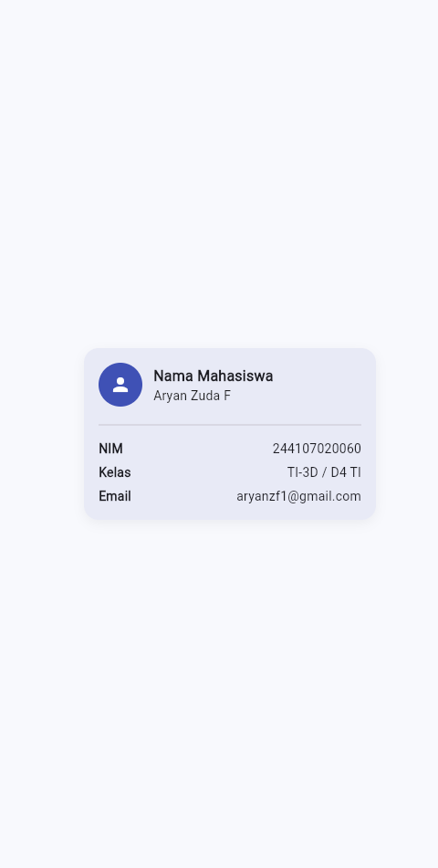
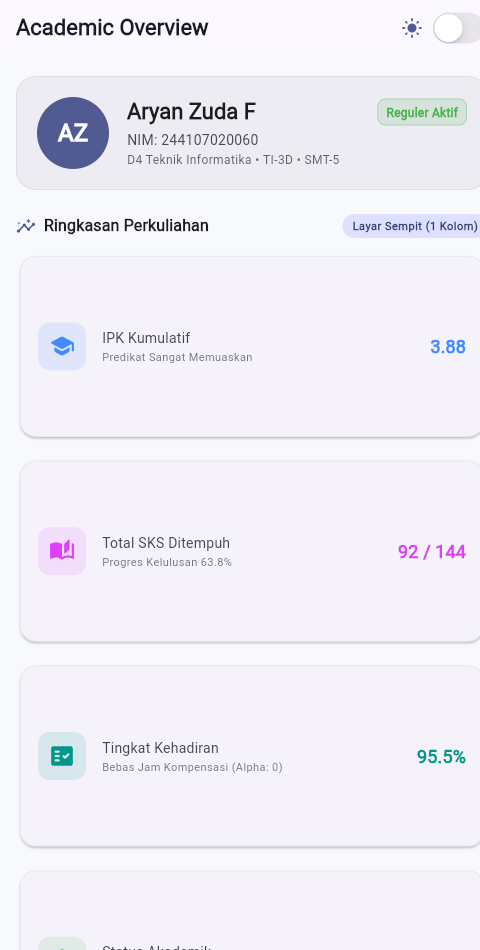
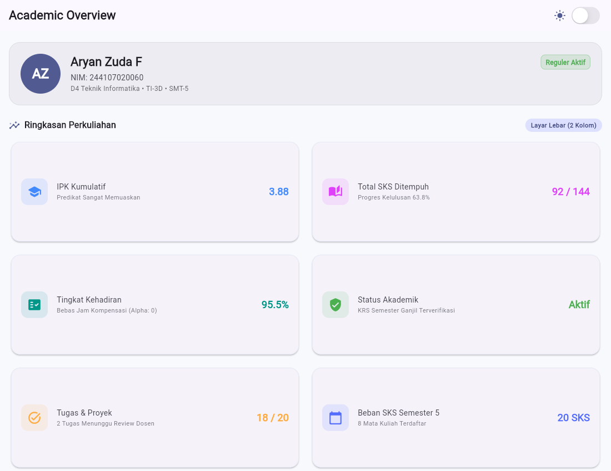
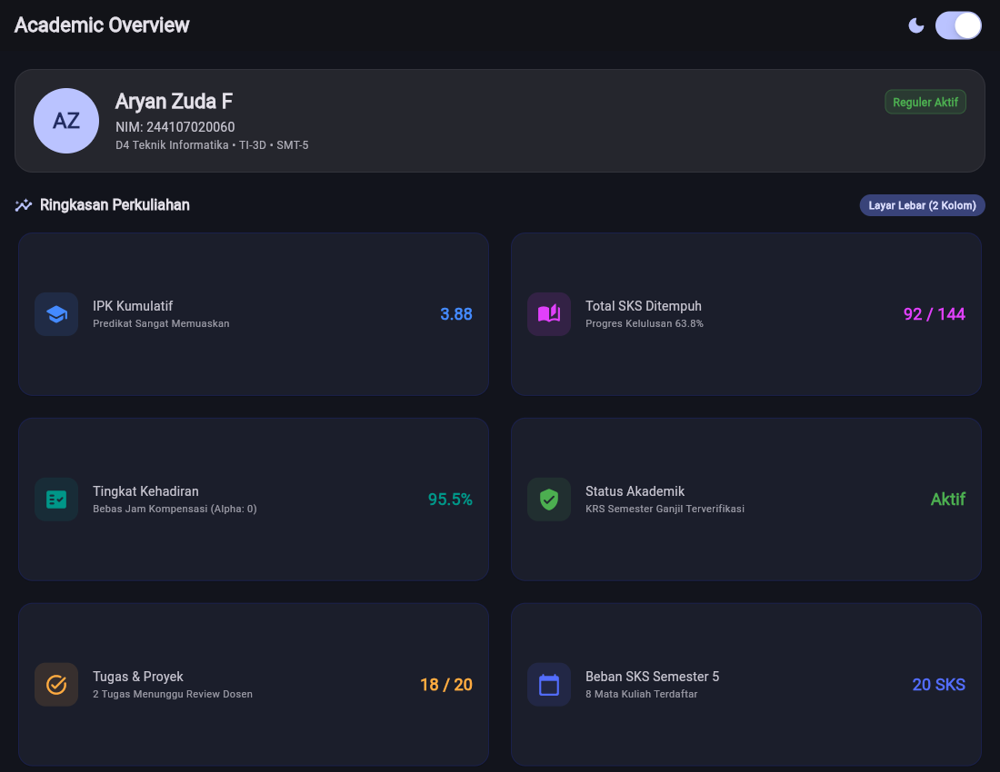
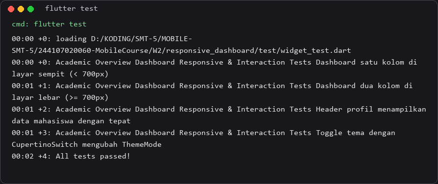
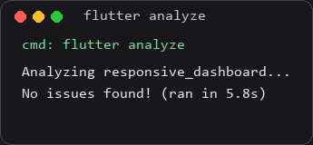

# 02 Week 2: Declarative UI and Responsive Design

Dokumentasi hasil pengerjaan Praktikum Pemrograman Mobile Minggu ke-2.
Dokumentasi ini telah berisi: screenshot, penjelasan, dan jawaban
pertanyaan dari praktikum.

## Identitas

| | |
| --- | --- |
| Nama | Aryan Zuda F |
| NIM | 244107020060 |
| Kelas | TI-3D |
| Program Studi | Teknik Informatika |
| Institusi | Politeknik Negeri Malang |

## Tujuan Praktikum

- Membangun dashboard akademik sederhana menggunakan Flutter.
- Menyusun tampilan menggunakan `Row`, `Column`, `Container`, dan `Expanded`.
- Membuat layout responsif untuk layar sempit dan layar lebar.
- Menampilkan kartu informasi akademik secara rapi dan mudah dipahami.
- Menerapkan pergantian light theme dan dark theme menggunakan `CupertinoSwitch`.
- Menambahkan `Semantics` agar informasi penting lebih mudah diakses screen reader.
- Memahami cara mencegah overflow pada widget `Row` dan `Expanded`.
- Menguji tampilan aplikasi menggunakan ukuran layar yang berbeda.

## Praktikum: Layout Sederhana (Warm-up)

Kartu profil pemanasan (`ProfileCard`): avatar, nama, NIM, kelas, dan
baris email tambahan. Kode: [`lib/profile_warmup.dart`](lib/profile_warmup.dart).

| **Warm-up**  |
| --- |

### Eksperimen Warm-up

1. **Expanded** — `Expanded` pada kolom nama saya lepas, teks yang agak
   panjang langsung menabrak tepi kartu (overflow kanan). Setelah
   `Expanded` dipasang lagi, `Row` membagi ruang dengan benar dan teks
   membungkus rapi.
2. **Main Axis** — `mainAxisSize: MainAxisSize.min` saya ganti ke `max`,
   kartu meregang setinggi layar dan area bawahnya kosong melompong.
   Dikembalikan ke `min` supaya kartu hanya setinggi isinya.
3. **Email** — baris Email saya tambah dengan pola `Row` + `Expanded`
   yang sama seperti baris NIM dan Kelas, sehingga label di kiri dan
   alamat email sejajar rapi di kanan.

## Praktikum: Dashboard Responsif

Halaman Academic Overview: header profil + 6 kartu ringkasan
perkuliahan dalam `GridView` yang jumlah kolomnya mengikuti lebar layar
(`LayoutBuilder`). Kode: [`lib/main.dart`](lib/main.dart).

### Eksperimen Layout

| **Layar Sempit**  Satu kolom | **Layar Lebar**  Dua kolom |
| --- | --- |

1. **Breakpoint** — konstanta `kWideBreakpoint = 700` di `lib/main.dart`.
   Di bawah 700 tampil satu kolom, 700 ke atas tampil dua kolom plus
   badge penanda mode kolom di subtitle.
2. **`themeMode`** — dikontrol state `isDark` lewat `CupertinoSwitch`
   di `AppBar`. Mode gelap tetap terbaca dengan kontras yang baik:

| **Dark Mode**  |
| --- |

3. **Ukuran layar** — diuji via widget test (`400x800` vs `1200x800`)
   dan screenshot Chrome (480px vs 1100px).
4. **`Semantics`** — label aksesibilitas pada header profil, tiap kartu
   (`Kartu ... bernilai ..., keterangan ...`), dan switch tema
   (`Beralih ke mode gelap/terang`, `toggled`).

## Tugas Utama: Academic Overview

Pada tugas utama, dashboard dikembangkan menjadi halaman
**Academic Overview** yang menampilkan informasi akademik mahasiswa
secara sederhana dan responsif.

### Fitur yang Diimplementasikan

- Menampilkan header profil mahasiswa (avatar AZ, nama, NIM, kelas TI-3D, badge Reguler Aktif).
- Menampilkan enam kartu informasi akademik:
  - IPK Kumulatif 3.88 (Predikat Sangat Memuaskan)
  - Total SKS Ditempuh 92 / 144 (Progres Kelulusan 63.8%)
  - Tingkat Kehadiran 95.5% (Bebas Jam Kompensasi)
  - Status Akademik Aktif (KRS Semester Ganjil Terverifikasi)
  - Tugas & Proyek 18 / 20 (2 Tugas Menunggu Review)
  - Beban SKS Semester 5: 20 SKS (8 Mata Kuliah)
- Menggunakan widget `Row` untuk menyusun elemen secara horizontal.
- Menggunakan widget `Column` untuk menyusun informasi secara vertikal.
- Menggunakan `Expanded` agar elemen menyesuaikan ruang yang tersedia.
- Menggunakan `Container` untuk membentuk area header profil.
- Menggunakan `LayoutBuilder` untuk menyesuaikan tampilan berdasarkan ukuran layar.
- Menampilkan satu kolom pada layar sempit.
- Menampilkan dua kolom pada layar lebar.
- Menyediakan light theme dan dark theme.
- Menambahkan toggle tema menggunakan `CupertinoSwitch`.
- Menambahkan label aksesibilitas menggunakan `Semantics`.

Hasil Implementasi

| **Academic Overview**  Satu kolom | **Academic Layar Lebar**  Dua kolom |
| --- | --- |

Screenshot diambil dari aplikasi yang dijalankan di **Chrome (web)**,
mode terang/gelap via query (`?theme=dark`) dan halaman warm-up via
(`?page=warmup`).

### Hasil

| **Hasil Test**  Semua Tes Berhasil |
| --- |

| **Hasil Analyze**  No issues found |
| --- |

Bukti teks lengkap: [`test/test_output.txt`](test/test_output.txt),
[`test/analyze_output.txt`](test/analyze_output.txt).

## AI Prompt Challenge (terdokumentasi)

Dilakukan **setelah** implementasi mandiri selesai:

1. **Prompt desain** — "Bandingkan `GridView` vs `LayoutBuilder` +
   `Column` untuk dashboard akademik Flutter (trade-off responsif dan
   aksesibilitas)." Keputusan saya: `LayoutBuilder` sebagai pembaca
   breakpoint yang membungkus `GridView.count` berkolom dinamis —
   kartu seragam lewat `childAspectRatio`, jumlah hanya 6 sehingga
   `shrinkWrap` aman, dan `Expanded` di tiap baris konten mencegah
   overflow di layar 360–400px.
2. **Prompt penguatan konsep** — "Kapan `Expanded` menyebabkan overflow
   di `Row`, contoh gagal + perbaikan." Jawabannya saya verifikasi
   lewat eksperimen warm-up di atas: `Expanded` butuh batas terhingga
   (bounded constraint); di dalam scroll searah sumbu yang sama ia
   melempar error constraint tak terbatas.
3. **Verification prompt** — responsif di bawah 600px (terbukti di
   400px dan 480px, 1 kolom), aksesibilitas tidak turun (label
   `Semantics` di kartu dan switch), semua widget dari Flutter stabil
   (termasuk `CardThemeData` dan `Color.withValues`).

## Refactoring Challenge

1. Kartu diekstrak jadi widget reusable `AcademicInfoCard(title, value,
   subtitle, icon, accentColor)` dan header jadi `ProfileHeaderSection`
   — tanpa duplikasi.
2. Warna/ukuran mengikuti `Theme.of(context)` agar otomatis ikut
   light/dark theme.
3. Breakpoint satu konstanta `kWideBreakpoint = 700`.
4. `flutter analyze` bersih, tanpa error/warning baru.

## Cara Menjalankan

```
cd 02-week-2-declarative-ui-responsive-design/responsive_dashboard
flutter pub get
flutter analyze
flutter test
flutter run -d chrome   # tambah ?page=warmup atau ?theme=dark di URL sesuai kebutuhan
```

## Refleksi

### 1. Perbedaan Imperative dan Declarative

Menurut saya, imperative itu menyuruh UI berubah langkah demi langkah
(misal cari view-nya dulu, baru ubah teksnya). Declarative seperti di
Flutter justru mendeskripsikan tampilan sebagai fungsi dari state:
saya cukup mengubah `isDark`, framework yang membangun ulang tema
tanpa saya menyentuh tiap kartu satu per satu.

### 2. Penggunaan Expanded

`Expanded` membantu saat dipakai di dalam `Row` atau `Column` yang
lebar/tingginya jelas, supaya anak widget berbagi sisa ruang dan teks
bisa membungkus. Ia jadi masalah kalau parent-nya tidak punya batas
yang pasti, misalnya `Row` di dalam scroll horizontal — waktu itu
Flutter protes karena batasnya tak terhingga.

### 3. Pengaruh Breakpoint dan Theme

Breakpoint menjaga keterbacaan: layar sempit satu kolom supaya teks
tidak terjepit, layar lebar dua kolom supaya ruang tidak mubazir.
Theme menjaga kenyamanan mata: terang untuk siang hari, gelap untuk
malam hari, dan keduanya harus tetap kontras supaya tulisan terbaca.

### 4. Verifikasi Rekomendasi AI

Setelah tugas utama selesai, saya uji saran AI satu per satu: layout
di layar 400px (tidak overflow), toggle tema terang–gelap (ikon ikut
berubah), dan label `Semantics` (terpasang di kartu dan switch).
API yang dipakai saya pastikan stabil di Flutter terbaru, bukan API
yang sudah deprecated.

## Checklist Verifikasi

- `flutter analyze` tidak menghasilkan error.
- `flutter test` berhasil dijalankan dan semua widget test responsif lulus.
- Aplikasi berhasil dijalankan pada ukuran layar sempit.
- Aplikasi berhasil dijalankan pada ukuran layar lebar.
- Tampilan berubah menjadi satu kolom pada layar sempit.
- Tampilan berubah menjadi dua kolom pada layar lebar.
- Dark mode memiliki kontras warna yang baik.
- Teks tetap terbaca pada light theme dan dark theme.
- Toggle tema dapat digunakan untuk berpindah antara light theme dan dark theme.
- Label aksesibilitas pada informasi dan tombol penting dapat dijelaskan.
- Struktur widget dapat dijelaskan saat code review.
- Screenshot layar sempit sudah tersimpan di folder `screenshots/`.
- Screenshot layar lebar sudah tersimpan di folder `screenshots/`.
- Folder `test/` sudah tersimpan pada folder tugas Week 2.
- File `README.md` sudah tersimpan pada folder tugas Week 2.
- Semua file tugas Week 2 sudah diperiksa sebelum dikumpulkan.

## Referensi

- [Dokumentasi UI Flutter](https://docs.flutter.dev/ui)
- [Membangun aplikasi responsif](https://docs.flutter.dev/ui/layout/responsive)
- [Material Design 3](https://m3.material.io/)
- [Aksesibilitas Flutter](https://docs.flutter.dev/ui/accessibility-and-internationalization/accessibility)
