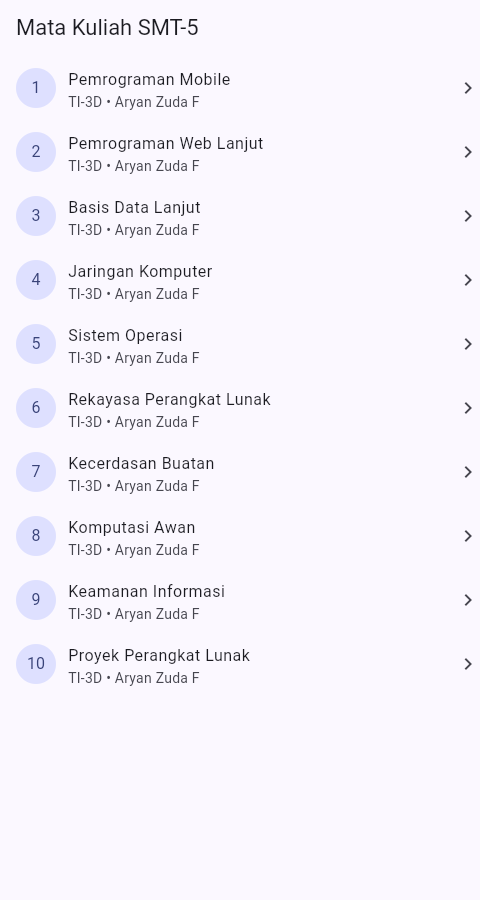
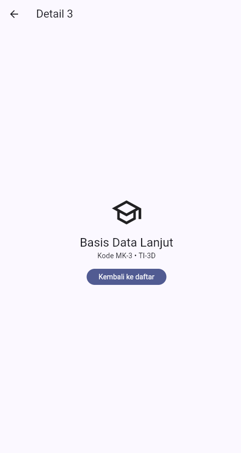
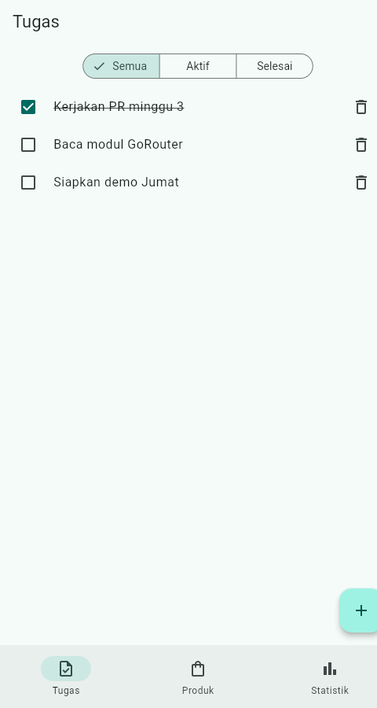
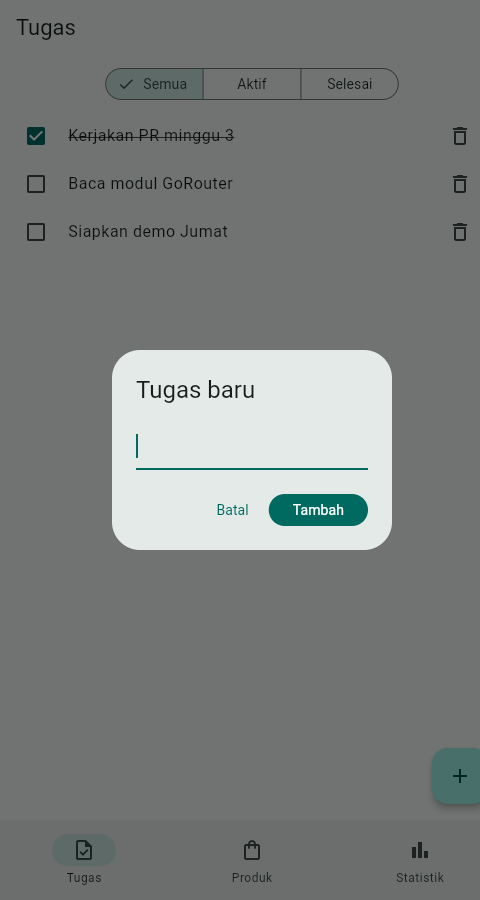
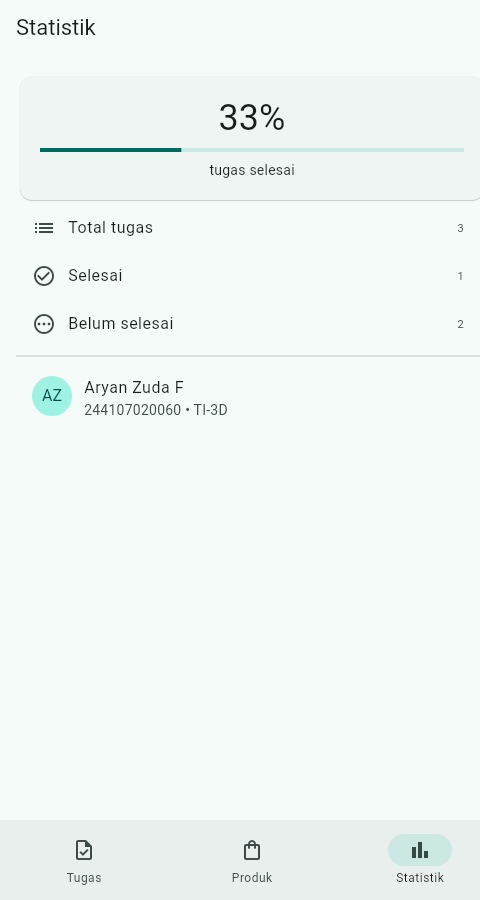
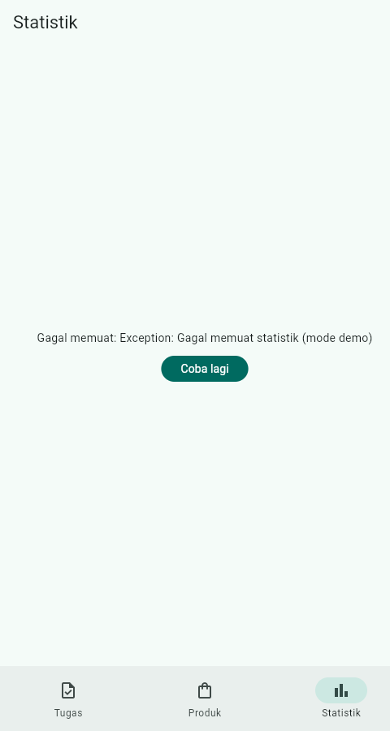
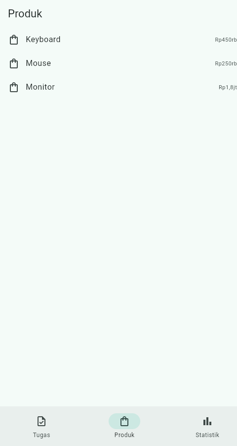

# 03 Week 3: Navigation & State Management

Tugas minggu ke-3 mata kuliah Pemrograman Mobile (JTI Polinema). Proyek
ini menggabungkan navigasi deklaratif dengan **GoRouter** dan state
management dengan **Riverpod**, lalu ditutup dengan simulasi data
asinkron memakai `AsyncValue`.

Nama: Aryan Zuda F (NIM 244107020060, Kelas TI-3D)

## Tujuan

- Menjelaskan konsep navigasi, route, serta perbedaan Navigator 1.0 dengan GoRouter.
- Menerapkan navigasi multi-page dengan GoRouter, termasuk path parameter dan deep link.
- Menjelaskan alasan state management dan cara kerja Riverpod (`Provider`, `ConsumerWidget`, `Notifier`).
- Menangani state loading, error, dan success dengan `AsyncValue`.
- Membangun aplikasi ToDo dengan navigasi dan Riverpod, lalu memverifikasinya dengan unit dan widget test.

## Fitur Utama

- Navigasi multi-halaman dengan GoRouter: `/` (daftar tugas), `/produk` (produk), dan `/stats` (statistik).
- `NavigationBar` untuk berpindah halaman tanpa kehilangan state.
- Daftar tugas dengan tambah, tandai selesai, dan hapus (`Notifier`, operasi berbasis id).
- Filter tugas: Semua, Aktif, Selesai (provider turunan).
- Halaman produk dengan simulasi pengambilan data asinkron: loading, error (dengan tombol **Coba lagi**), dan success.
- Halaman statistik dari daftar tugas asli: loading, error (dengan tombol **Coba lagi**), success, dan empty.

## Stack Teknologi

- Flutter 3.47 (Dart 3.13)
- `go_router` + `flutter_riverpod`
- `flutter_test` untuk unit dan widget test

## Struktur Folder

```text
03-week-3-navigation-state-management/
├── week3_navigation/             # Project Praktikum 1 (lihat README-nya)
│   └── README.md
├── week3_todo/                   # Project Praktikum 2 & 3 + AI Challenge
│   └── README.md
├── test/                         # Salinan test final (untuk portofolio)
│   ├── todo_provider_test.dart   # Unit test notifier + filter
│   ├── stats_provider_test.dart  # Unit test sukses & gagal
│   └── widget_test.dart          # Widget test tambah tugas & navigasi
├── docs/
│   └── ai-challenge.md           # Prompt, keputusan, perbaikan, hasil test
├── screenshots/
└── README.md
```

> Kode yang dapat dijalankan ada di subfolder `week3_navigation/` dan
> `week3_todo/` lokal (tidak di-push, hanya README-nya). Folder `test/`
> berisi salinan test final `week3_todo/` untuk dokumentasi portofolio.

## Struktur Project

Folder ini punya README keseluruhan (file ini) dan README tiap project:

- `week3_navigation/` - Praktikum 1 (navigasi GoRouter). Struktur:
  `lib/` (`main.dart`, `pages/home_page.dart`, `pages/detail_page.dart`)
  dan `test/`. Detailnya ada di
  [`week3_navigation/README.md`](week3_navigation/README.md).
- `week3_todo/` - Praktikum 2 & 3 + AI Challenge (ToDo + Riverpod).
  Struktur: `lib/` (`main.dart`, `pages/`, `providers/`, `widgets/`)
  dan `test/`. Detailnya ada di
  [`week3_todo/README.md`](week3_todo/README.md).

## Praktikum 1 - Navigasi dengan GoRouter

Project `week3_navigation` menampilkan daftar 10 mata kuliah Semester 5.
Menekan sebuah item membuka `/detail/:id` lewat path parameter, dan path
detail dapat diakses langsung tanpa melewati Home.

| **Home**  | **Detail**  |
| --- | --- |

## Praktikum 2 - ToDo dengan Riverpod

State daftar tugas disimpan pada `TodoListNotifier` dan dibaca UI lewat
`ref.watch`. Setiap perubahan selalu membuat list baru (immutable), dan
callback memakai `ref.read(...notifier)`.

| **Daftar Tugas**  | **Tambah Tugas**  |
| --- | --- |

## Praktikum 3 - AsyncValue dan AI Challenge

Halaman `StatsPage` memakai `AsyncNotifier` yang mensimulasikan request
(delay 800ms, mode gagal deterministik via `?stats=fail`). Ketiga kondisi
ditangani dengan `AsyncValue.when`:

- **loading**: spinner + label "Memuat statistik..."
- **error**: pesan gagal + tombol **Coba lagi** (`ref.invalidate`)
- **success**: panel persentase selesai + tiga baris (Total tugas, Selesai, Belum selesai)
- **empty**: saat belum ada tugas, ditampilkan pesan "Belum ada tugas"

| **Statistik**  | **Error + Coba lagi**  |
| --- | --- |

Statistik dihitung dari daftar tugas sebenarnya (total, selesai, belum
selesai), bukan angka hardcoded. Detail prompt, keputusan, perbaikan, dan
hasil test ada di [`docs/ai-challenge.md`](docs/ai-challenge.md).

Halaman produk (`/produk`) memakai pola yang sama untuk daftar produk:

| **Produk**  |
| --- |

## Refactoring Challenge

1. **`TodoTile`** dipisah menjadi widget tersendiri di `lib/widgets/`.
2. **Logika filter** diekstrak menjadi `filteredTodosProvider`, sebuah
   `Provider` turunan yang membaca `todoListProvider` dan `todoFilterProvider`.
3. **Integrasi GoRouter**: `/` untuk daftar tugas, `/produk` untuk produk,
   dan `/stats` untuk statistik, dengan `NavigationBar` untuk berpindah
   halaman (state tiap tab tetap hidup via `StatefulShellRoute`).

## Testing

```bash
cd week3_todo
flutter test
```

Hasil:

```text
00:04 +7: All tests passed!
```

(2 unit notifier + filter, 2 unit stats sukses/gagal, 3 widget:
tambah tugas, pindah tab statistik, loading→daftar produk.)

Analisis statis:

```bash
flutter analyze   # No issues found!
```

(`week3_navigation/`: 2 test lulus, `flutter analyze` bersih.)

## Cara Menjalankan

```bash
cd week3_todo
flutter pub get
flutter run -d chrome
```

Aplikasi membuka halaman **Tugas** lebih dulu. Tab **Tugas**,
**Produk**, dan **Statistik** tersedia lewat `NavigationBar` di bawah.
Query demo web: `?demo=seed` (data contoh), `?stats=fail` /
`?produk=fail` (simulasi error), `?dialog=add` (buka dialog tambah).

## AI Verification Checklist

| Item | Status | Catatan |
| --- | --- | --- |
| State diubah secara immutable | ✅ | `add`/`toggle`/`remove` selalu membuat list baru |
| `ref.watch` di `build`, `ref.read` di callback | ✅ | Tidak ada `watch` di dalam callback |
| Ketiga state AsyncValue ditangani | ✅ | loading, error, success (+ empty) |
| Provider bertipe eksplisit dan tidak duplikat | ✅ | `NotifierProvider` / `AsyncNotifierProvider` |
| Tidak memakai API Riverpod lama | ✅ | Tanpa `StateProvider`/`StateNotifierProvider` |
| Retry otomatis dimatikan | ✅ | `retry: (...) => null` agar error bertahan |
| `flutter analyze` dan `flutter test` lolos | ✅ | Bersih, 7 test lulus |

## Refleksi

1. **Kapan `setState` cukup, kapan harus Riverpod?**
   `setState` cukup untuk state lokal satu widget, misalnya isi
   `TextField` dialog tambah atau toggle tema. Riverpod saya pakai saat
   state dibagi antar halaman — daftar tugas ditulis di tab Tugas tapi
   dibaca juga di tab Statistik — dan harus tetap hidup saat widgetnya
   tidak tampil.
2. **`context.go` vs `context.push`?**
   `go` mengganti stack (cocok untuk pindah tab dan redirect),
   `push` menumpuk halaman (cocok untuk detail agar tombol back kembali
   ke daftar). Di `NavigationBar` saya pakai `goBranch` yang semantiknya
   seperti `go` supaya tab tidak menumpuk.
3. **Bagaimana `AsyncValue` mencegah bug dibanding tiga boolean?**
   Tiga boolean bisa berada di kombinasi mustahil (loading sekaligus
   error). `AsyncValue` satu tipe dengan kondisi saling eksklusif, dan
   `AsyncValue.guard` mengubah exception menjadi `AsyncError` tanpa
   `try/catch` yang tersebar.
4. **Bagian hasil AI yang diperbaiki?**
   Delay/failure dibuat deterministik (bukan acak 30%) agar bisa diuji,
   retry otomatis Riverpod 3 dimatikan agar error bertahan sampai retry
   manual, operasi todo berbasis id (bukan index) agar benar saat filter
   aktif, serta statistik dihitung dari data asli bukan hardcoded.

## Checklist Verifikasi Mandiri

- Navigasi GoRouter bekerja: pindah halaman, back, dan akses path detail langsung.
- `ProviderScope` membungkus root aplikasi; state ToDo bertahan saat berpindah halaman.
- UI `AsyncValue` menangani loading, error, dan success, bukan hanya success.
- `flutter analyze` tanpa issue dan semua test lulus.
- Hasil AI diverifikasi dan didokumentasikan pada folder `docs/`.
