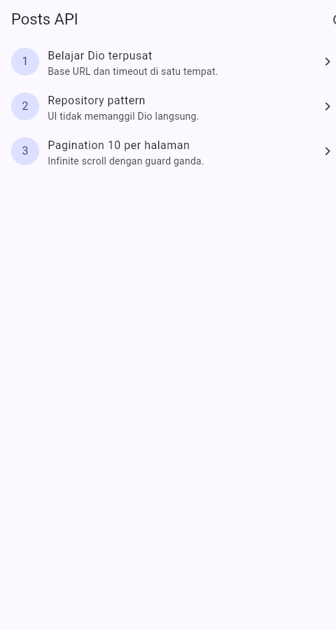
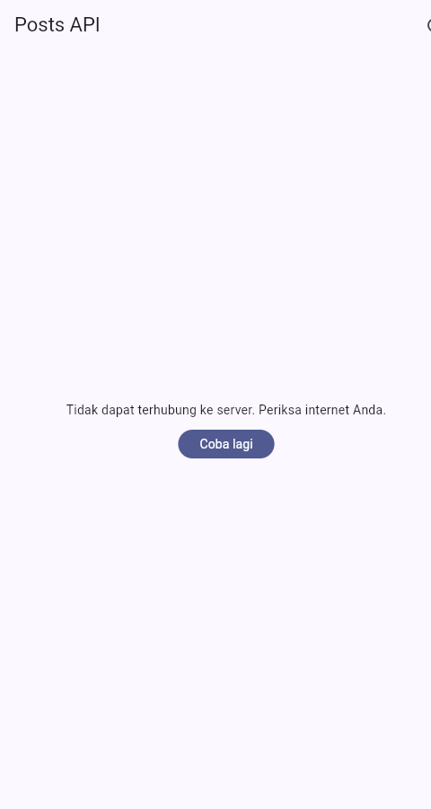
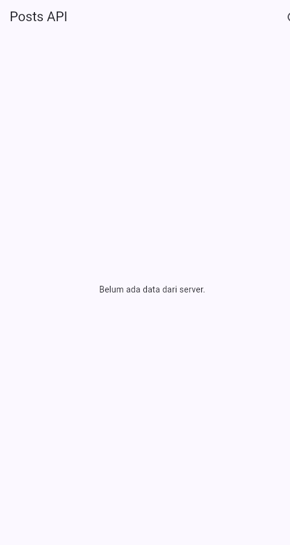
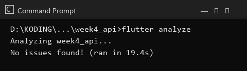
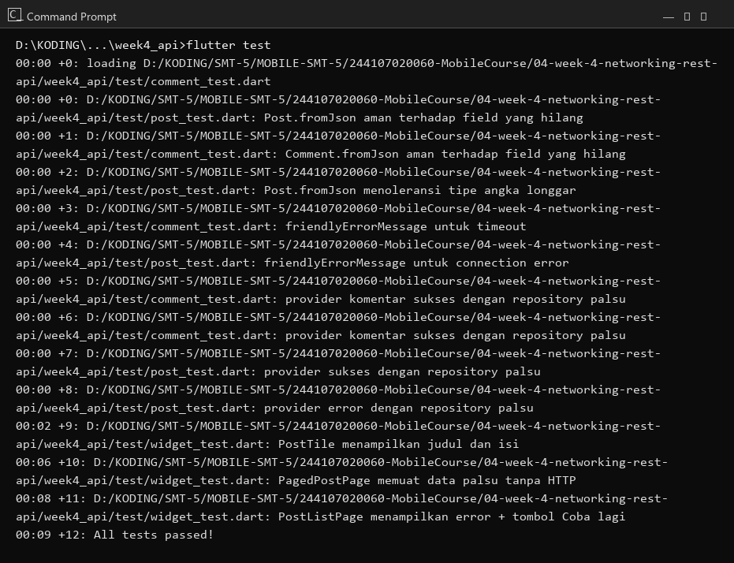

# 04 Week 4: Networking & REST API

Tugas minggu ke-4 mata kuliah Pemrograman Mobile (JTI Polinema). Proyek
ini mengambil data dari REST API publik, memetakannya ke model Dart yang
aman null, dan menampilkannya lewat repository + Riverpod dengan
penanganan state loading, error, empty, dan success, ditutup dengan
pagination (infinite scroll).

Nama: Aryan Zuda F (NIM 244107020060, Kelas TI-3D)

## Tujuan

- Menjelaskan konsep HTTP, REST API, dan JSON.
- Memetakan JSON ke model Dart dengan `fromJson` yang aman null.
- Menerapkan repository pattern sehingga UI tidak memanggil API secara langsung.
- Mengonfigurasi Dio (base URL, timeout, interceptor) di satu tempat.
- Menampilkan state loading, error, empty, dan success dengan `AsyncValue`.
- Menerapkan pagination dasar (infinite scroll) dengan guard request ganda.

## Fitur Utama

- Klien HTTP terpusat `dio` dengan `baseUrl`, timeout 10 detik, dan `LogInterceptor`.
- Model `Post` dan `Comment` dengan `fromJson` aman null (plus toleransi angka-dalam-string).
- `PostRepository` (`fetchPosts`, `fetchPost`, `fetchPostsPage`) dan
  `CommentRepository` (`fetchComments`) sebagai satu-satunya pintu ke API.
- Halaman daftar penuh (`/simple`) dengan keempat state: loading, error +
  tombol **Coba lagi**, empty, dan success.
- Halaman paginated (`/`) dengan infinite scroll 10 item per halaman dan
  indikator akhir data ("Semua data termuat.").
- Halaman detail (`/post/:id`) menampilkan judul, isi, dan komentar dari
  endpoint `GET /comments?postId={id}`.
- Pesan error ramah pengguna untuk timeout, connection error, 404, dan 5xx.
- 12 test lulus (unit model + error mapping, provider dengan repository
  palsu, dan widget test) tanpa HTTP sungguhan.

## Stack Teknologi

- Flutter 3.47 (Dart 3.13)
- `dio` ^5.11
- `flutter_riverpod` ^3
- `go_router` ^18
- `flutter_test` untuk unit dan widget test

## Struktur Folder

```text
04-week-4-networking-rest-api/
├── week4_api/                 # Project Flutter yang dapat dijalankan
│   ├── lib/
│   │   ├── main.dart          # ProviderScope + GoRouter (/ , /simple, /post/:id)
│   │   ├── data/
│   │   │   ├── api_client.dart      # createDio() terpusat
│   │   │   ├── json.dart            # jsonInt/jsonStr defensif
│   │   │   ├── providers.dart       # dioProvider, repository, notifier
│   │   │   ├── paged_posts.dart     # PagedPostsState + notifier
│   │   │   ├── network_errors.dart  # friendlyErrorMessage
│   │   │   ├── preview_fakes.dart   # Fakes khusus screenshot (?demo=)
│   │   │   ├── models/ (post.dart, comment.dart)
│   │   │   └── repositories/ (post_repository.dart, comment_repository.dart)
│   │   ├── pages/ (post_list_page.dart, paged_post_page.dart, post_detail_page.dart)
│   │   └── widgets/post_tile.dart
│   └── test/
│       ├── post_test.dart     # fromJson, error mapping, provider sukses/gagal
│       ├── comment_test.dart  # Comment.fromJson + timeout + provider komentar
│       ├── widget_test.dart   # PostTile, paged, dan error + retry
│       └── fakes.dart         # repository palsu (tanpa HTTP)
├── lib/                       # Salinan kode final (untuk portofolio)
├── test/                      # Salinan test final (untuk portofolio)
├── docs/
│   └── ai-challenge.md        # Prompt, keputusan, perbaikan, hasil test
├── screenshots/
└── README.md
```

> Kode yang dapat dijalankan ada di subfolder `week4_api/` (di-ignore
> oleh Git). Folder `lib/` dan `test/` berisi salinan final untuk
> dokumentasi portofolio, mengikuti konvensi minggu sebelumnya.

## Alur Data

```text
UI (ConsumerWidget) --watch--> Provider (AsyncValue)
Provider --panggil--> Repository --pakai--> Dio --HTTP--> REST API
```

UI tidak pernah memanggil Dio langsung. Repository membiarkan exception
naik, provider mengubahnya menjadi `AsyncError`, dan UI memetakan ke
pesan ramah lewat `friendlyErrorMessage`.

## 1. Model data dengan `fromJson` aman null

`Post` dan `Comment` memakai helper `jsonInt`/`jsonStr`
(`lib/data/json.dart`) agar field hilang, null, bahkan angka dalam
bentuk string (`"3"`) tidak membuat aplikasi crash.

## 2. Dio terpusat

Seluruh konfigurasi jaringan hidup di `lib/data/api_client.dart`.
`baseUrl` dapat ditimpa saat run untuk menguji error:

```bash
flutter run --dart-define=API_BASE_URL=https://localhost:9/ -d chrome
```

## 3. Empat state UI

Setiap state mendapat tampilannya sendiri:

- **loading**: `CircularProgressIndicator`.
- **error**: pesan ramah + tombol **Coba lagi** (`ref.invalidate`).
- **empty**: teks "Belum ada data dari server."
- **success**: daftar `PostTile` dengan `RefreshIndicator`.

| **Daftar penuh**  | **Error**  |
| --- | --- |

Empty state saat server tidak mengembalikan data:

| **Empty**  |
| --- |

## 4. Pagination (infinite scroll)

`ScrollController` memicu halaman berikutnya 200px sebelum ujung list.
Guard `if (state.isLoadingMore || !state.hasMore) return;` mencegah
request ganda dan menghentikan request saat data habis, sementara
indikator "Semua data termuat." menutup daftar.

| **Paged**  |
| --- |

## 5. Halaman detail + komentar (AI Challenge)

Halaman `/post/:id` menampilkan judul dan isi lengkap. Bila dibuka dari
daftar, data dikirim lewat `extra`; bila dibuka langsung,
`postDetailProvider` mengambil ulang dari repository. Komentar diambil
dari `GET /comments?postId={id}`.

| **Detail + komentar**  |
| --- |

Detail prompt, keputusan, verifikasi, dan perbaikan ada di
[`docs/ai-challenge.md`](docs/ai-challenge.md). Screenshot demo memakai
`?demo=seed|error|empty` agar deterministik tanpa HTTP.

## Refactoring Challenge

1. **`PostTile`** dipisah menjadi widget tersendiri di `lib/widgets/`
   agar `ListView.builder` pendek dan mudah diuji.
2. **`friendlyErrorMessage`** dipindah ke `lib/data/network_errors.dart`
   agar dipakai ulang halaman daftar, paged, dan detail.
3. **Halaman detail** `/post/:id` dengan GoRouter menampilkan `title`
   dan `body` lengkap, dengan state detail dari list yang sudah dimuat
   atau via repository bila dibuka langsung.

## Testing

```bash
cd week4_api
flutter analyze
flutter test
```

Hasil:

```text
Analyzing week4_api...
No issues found!

00:02 +12: All tests passed!
```

| **`flutter analyze`**  | **`flutter test`**  |
| --- | --- |

## Cara Menjalankan

```bash
cd week4_api
flutter pub get
flutter run -d chrome
```

Aplikasi membuka halaman **Posts Paged** (`/`). Ikon daftar di kanan
atas membuka daftar penuh (`/simple`), dan menekan sebuah post membuka
halaman detail (`/post/:id`).

## AI Verification Checklist

| Item | Status | Catatan |
| :--- | :---: | :--- |
| UI tidak memanggil Dio langsung | ✅ | UI hanya `ref.watch` provider |
| `fromJson` aman null | ✅ | `jsonInt`/`jsonStr`, termasuk angka-string |
| Semua `DioExceptionType` dipetakan | ✅ | timeout, connectionError, badResponse (404/401/403/5xx) |
| `baseUrl`/timeout terpusat | ✅ | `createDio()` di `api_client.dart` |
| Test menguji field hilang + edge case | ✅ | Field hilang, angka-string, 404, provider sukses/gagal |
| `flutter analyze` dan `flutter test` lolos | ✅ | Bersih, 12 test lulus |

## Checklist Verifikasi Mandiri

- [x] UI tidak memanggil Dio langsung, semua akses data lewat repository + provider.
- [x] Empat state tampil benar: loading, error (+ retry), empty, success.
- [x] Pagination: data bertambah saat scroll, tidak ada request ganda, ada indikator akhir data.
- [x] `flutter analyze` tanpa issue dan semua test lulus.
- [x] Hasil AI diverifikasi dan didokumentasikan pada folder `docs/`.

## Refleksi

1. **Mengapa UI dilarang memanggil Dio langsung?**
   Karena UI jadi butuh jaringan sungguhan untuk diuji, sumber data
   sulit diganti, dan pemetaan error tersebar di banyak widget. Dengan
   repository, UI hanya bergantung pada provider dan seluruh test saya
   berjalan dengan repository palsu tanpa internet.
2. **Kapan pagination client-side cukup, kapan server-side?**
   Client-side cukup bila datanya kecil dan sudah dimuat sekaligus.
   Server-side (`_page`/`_limit`) saya pakai di sini karena API
   menyediakan 100 post — hanya halaman yang dibutuhkan yang dikirim
   sehingga memori perangkat tetap hemat.
3. **Bagaimana exception menjadi `AsyncError` tanpa try/catch di tiap widget?**
   `AsyncNotifier.build` yang melempar exception otomatis diubah Riverpod
   menjadi `AsyncError`. `try/catch` eksplisit (via `AsyncValue.guard`)
   tetap saya pakai di `refresh()` karena state ditetapkan manual.
4. **Bagian hasil AI yang diperbaiki?**
   `fromJson` diperkuat dengan helper toleran-tipe (temuan edge-case
   test), family provider disesuaikan API Riverpod 3.4.3
   (`AsyncNotifierProvider.family`), override demo di-inline karena tipe
   `Override` tidak publik, dan retry otomatis dimatikan agar error final.

## Referensi

- [Dio package](https://pub.dev/packages/dio)
- [JSONPlaceholder (API dummy)](https://jsonplaceholder.typicode.com)
- [Riverpod: AsyncNotifier dan AsyncValue](https://riverpod.dev/docs/concepts/async_notifiers)
- [Flutter cookbook: Fetch data from the internet](https://docs.flutter.dev/cookbook/networking/fetch-data)
