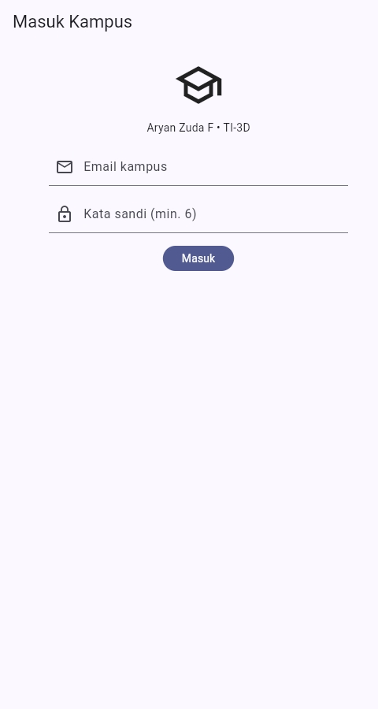
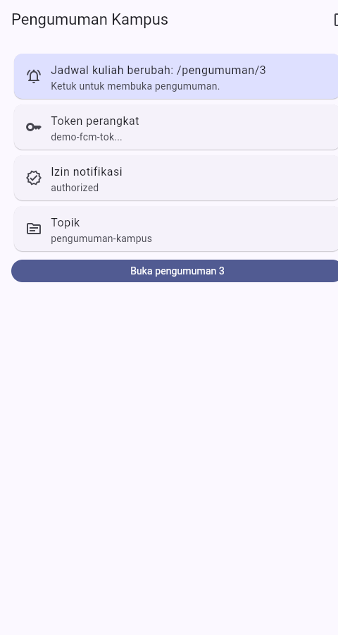
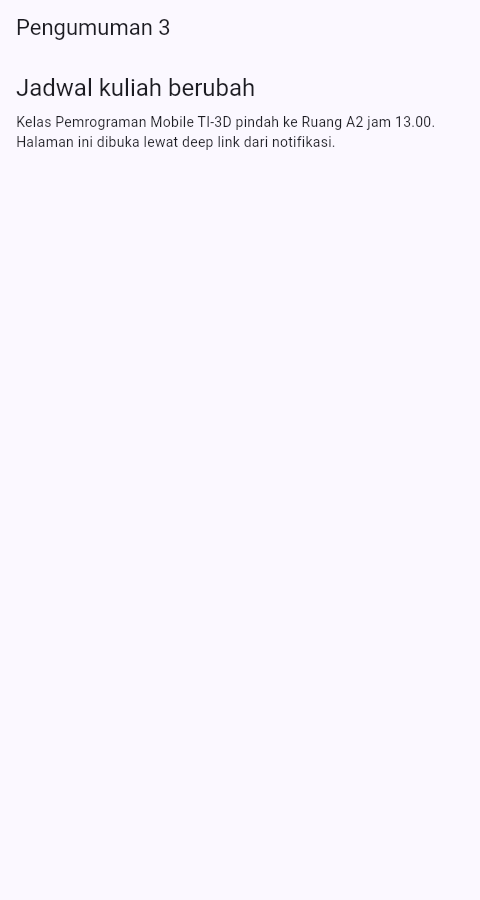
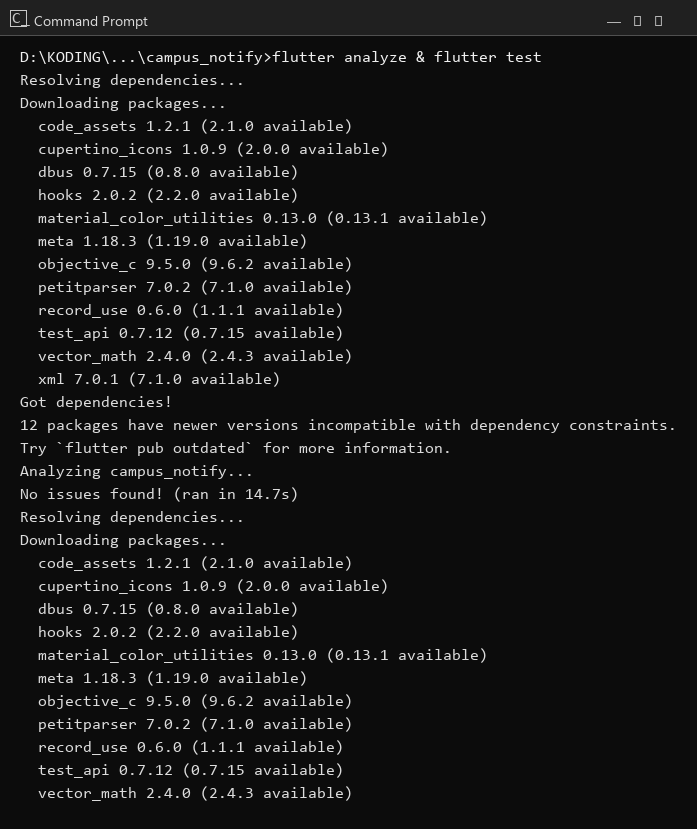

# Minggu 6 — Authentication, Security & FCM

Login mock + route guard, penyimpanan token di
`flutter_secure_storage` (Keychain/Keystore) dengan preview aman,
interceptor Dio refresh-sekali otomatis, dan push notifikasi via
FCM (`firebase_messaging` + `flutter_local_notifications`) dengan
topik `pengumuman-kampus`.

**Aryan Zuda F · NIM 244107020060 · TI-3D**

## Gambaran aplikasi

`AuthRepository` (mock login/refresh yang bisa diganti `FirebaseAuth`)
menghasilkan sesi `access` (pendek) + `refresh` (panjang). `TokenStore`
menyimpan keduanya lewat `FlutterSecureStorage` (atau `MemoryTokenBackend`
untuk web/demo/test); token penuh **tidak pernah** tampil di UI/log, hanya
`tokenPreview()` (12 karakter + `...` — lihat `token_store.dart`).

`GoRouter` memakai `redirect` untuk *guard*: belum login → paksa ke
`/login`; sudah login → blokir kembali ke `/login`. `AuthNotifier`
(`AsyncNotifier<bool>`) menjadi sumber kebenaran status login; `logout()`
clear token + invalidate diri.

Interceptor Dio (`buildApiClient`) menyelipkan header `Bearer` otomatis,
dan pada **401** mencoba *refresh sekali* lewat flag `__retried`; bila
refresh gagal, `store.clear()` + panggil `onRefreshFailed` → logout paksa
ke `/login`. Pesan error diterjemahkan oleh `apiErrorMessage` (timeout,
koneksi, 401, 404) agar UI hanya dapat string ramah.

FCM melalui kontrak abstrak `PushService` dengan dua implementasi:
`FirebasePushService` (perangkat asli) dan `FakePushService`
(web/demo/test, deterministik). Handler background adalah fungsi
**top-level** + `@pragma('vm:entry-point')` sehingga tidak pernah
mengakses `BuildContext`/`Riverpod`. Foreground menampilkan notifikasi
lokal manual + banner in-app; klik banner atau notifikasi → deep link ke
`/pengumuman/:id` lewat `routeFromMessage`.

Firebase di-`main()` dikelilingi `try/catch` sehingga tanpa
`google-services.json` aplikasi tetap berjalan di mode demo
`?demo=login|home|banner`; tambah `?banner=1` (mis. `?demo=banner&banner=1`)
untuk banner foreground otomatis di screenshot.

**Stack:** Flutter 3.47 (Dart 3.13) · `flutter_riverpod` ^3 ·
`go_router` ^18 · `dio` ^5 · `flutter_secure_storage` ^11 ·
`firebase_core` ^4 · `firebase_messaging` ^16 ·
`flutter_local_notifications` ^22 · `flutter_test`.

## Isi folder

```text
06-week-6-authentication-security-fcm/
├── campus_notify/        # Project Flutter yang dapat dijalankan
│   ├── lib/
│   │   ├── main.dart            # Firebase guarded init + GoRouter guard + demo ?demo=
│   │   ├── routes.dart          # konstanta rute + topik + endpoint devices
│   │   ├── data/
│   │   │   ├── auth_repository.dart   # mock login/refresh (ganti Firebase Auth)
│   │   │   ├── token_store.dart       # secure/memori + tokenPreview()
│   │   │   ├── api_client.dart        # interceptor refresh-sekali
│   │   │   └── api_errors.dart        # apiErrorMessage()
│   │   ├── messaging/push_service.dart  # routeFromMessage murni, handler BG,
│   │   │                            # FirebasePushService + FakePushService
│   │   ├── providers/auth_provider.dart  # token/auth/api/push provider + AuthNotifier + PushUiNotifier
│   │   └── pages/ (login_page.dart, home_page.dart, announcement_page.dart)
│   └── test/
│       ├── auth_push_test.dart  # unit: route/token/auth/TokenStore/Dio-refresh
│       └── widget_test.dart     # widget: login error, home, banner deep link
├── lib/                    # Salinan kode final (untuk portofolio)
├── test/                   # Salinan test final (untuk portofolio)
├── docs/
│   └── ai-challenge.md     # Prompt FCM, keputusan, tabel state, verifikasi, perbaikan
├── screenshots/
└── README.md
```

> Yang bisa dijalankan ada di `campus_notify/` (di-ignore Git).
> `lib/` dan `test/` adalah salinan final untuk portofolio.

## Alur auth + refresh otomatis

**Login** (`/login`).


**Kredensial ditolak** — `AuthRepository` melempar, UI menampilkan pesan
ramah dari `apiErrorMessage`.


```text
UI (LoginPage/HomePage) --watch--> authStateProvider (AsyncNotifier<bool>)
AuthNotifier.login(email,pw)
  -> AuthRepository.login() -> access+refresh
  -> TokenStore.save() (secure storage)
  -> state = true  -> GoRouter redirect masuk ke /

API call lewat Dio (Interceptor)
  --onRequest-->  tambahkan header Bearer access
  --401-->      baca refresh, auth.refresh(), simpan access baru, retry SEKALI (flag __retried)
  --refresh gagal--> store.clear() + onRefreshFailed -> logout() -> /login
```

Token penuh tidak pernah tampil: semua log/preview lewat `tokenPreview()`.

**Beranda** — token terpotong (`demo-fcm-tok...`), izin `authorized`,
topik `pengumuman-kampus`.


## Push (FCM)

- `requestPermission` → status (`authorized`/`denied`).
- `initToken(onToken)` → dapatkan token, kirim ke `POST /devices` via
  callback (didokumentasikan di README; demo memakai endpoint mock).
- `onTokenRefresh` → pantau rotasi/reinstall, teruskan token baru ke backend.
- `listenForeground()` → `onMessage` → notifikasi lokal + banner in-app.
- Topik `pengumuman-kampus` via `subscribeTopic`/`unsubscribeTopic`.
- Deep link: `routeFromMessage(data)` (fungsi murni, diunit-test) →
  navigasi ke `/pengumuman/:id`.

**Foreground** — banner in-app muncul saat notifikasi masuk (sistem tidak
menampilkan banner di foreground, jadi manual).


**Klik banner → deep link** ke tujuan `data.route` (`/pengumuman/3`).


**Perbedaan Android 13 vs iOS** (dokumentasi di komentar
`FirebasePushService.listenForeground`): Android 13+ memerlukan izin runtime
`POST_NOTIFICATIONS`; iOS memerlukan capability Push Notifications + APNs.
Kode demo tidak cabang platform; kedua perbedaan didokumentasikan saja.

## Tabel tiga app state (bukti deterministik via Fake)

| State | Yang diharapkan | Cara uji (demo) |
| --- | --- | --- |
| Foreground | Banner in-app muncul, klik masuk `/pengumuman/3` | `?demo=banner&banner=1`, klik banner |
| Background | Banner sistem + klik ke rute benar | `onMessageOpenedApp` → `routeFromMessage` (unit-test) |
| Terminated | Buka ke rute benar via `getInitialMessage` | `handleTerminated` + `routeFromMessage` (unit-test) |

## Saya refactor

- **`PushService`** abstrak + `FakePushService` agar web/demo/test
  deterministik tanpa Firebase/HTTP sungguhan.
- **`routeFromMessage`** jadi fungsi murni (payload → rute) yang
  diunit-test terpisah.
- **`tokenPreview()`** memastikan token penuh tak pernah beredar ke UI/log.
- **Handler background** jadi top-level + pragma, bebas `BuildContext`.
- **Interceptor Dio** dibatasi refresh sekali via flag `__retried`.
- **Router GoRouter di-cache di State** (dibuat ulang hanya saat status
  login berubah) agar halaman tidak di-remount tiap rebuild — login
  tidak mengulang dan teks error tidak hilang.

## Bukti uji

```bash
cd campus_notify
flutter analyze
flutter test
```

```text
Analyzing campus_notify...
No issues found!

00:04 +12: All tests passed!
```



## Menjalankan

```bash
cd campus_notify
flutter pub get
flutter run -d chrome            # mode demo (tanpa Firebase)
```

Query demo web: `?demo=login` (belum login), `?demo=home` (sudah login,
token memori + FakePush), `?demo=banner&banner=1` (sudah login + banner
foreground otomatis).

Untuk Firebase asli: buat project di Firebase Console, taruh
`google-services.json` di `android/app/` dan `GoogleService-Info.plist`
di `ios/Runner/`. `Firebase.initializeApp()` sudah dipanggil guarded di
`main()`, dan `FirebasePushService` siap dipakai ganti `FakePushService`
di `pushServiceProvider` (override di `main`/`test`).

## Hasil verifikasi AI saya

- Kontrak `PushService` + dua implementasi: benar, web/demo/test pakai
  `Fake` (deterministic) dan perangkat pakai `Firebase`.
- Handler background jadi top-level + `@pragma('vm:entry-point')`:
  benar, tidak ada `BuildContext`/`Riverpod` di dalamnya.
- `onTokenRefresh` hanya di-log → saya wajibkan kirim ke backend lewat
  callback `onToken`, lalu `POST /devices` oleh pemanggil.
- Token penuh tampil di debug → diganti `tokenPreview()` (12 karakter).
- `flutter_local_notifications` disesuaikan API yang ada (init + `show`
  + payload berupa route).
- Firebase dibuat opsional (guarded init) agar demo web dan test jalan
  tanpa `google-services.json`.
- Perbedaan Android 13+ vs iOS didokumentasikan di komentar, tidak
  dicabangkan di kode demo.
- Router dibuat ulang tiap rebuild → login mengulang & error tak tampil;
  saya cache `GoRouter` di State, dibuat ulang hanya saat status login
  berubah (ditemukan saat screenshot error tak kunjung muncul).

## Checklist saya

- [x] Login mock + simpan access/refresh di secure storage.
- [x] `tokenPreview()`; token penuh tak pernah tampil di UI/log.
- [x] GoRouter guard: belum login → `/login`; sudah login → blokir `/login`.
- [x] Interceptor Dio refresh sekali (401 → refresh → retry; refresh mati
  → clear + logout).
- [x] FCM: permission, token, `onTokenRefresh` ke backend, topik subscribe,
  foreground notification + banner, deep link `/pengumuman/:id`.
- [x] Handler background top-level + pragma, bebas BuildContext.
- [x] `FirebasePushService` vs `FakePushService`; demo web `?demo=`
  deterministik.
- [x] `flutter analyze` tanpa issue, semua test (12) lulus.
- [x] Hasil AI terdokumentasi di `docs/`.

## Refleksi

**Mengapa access & refresh dipisah?** Access pendek (bisa dicabut/leak
kecil) dan hanya dipakai header; refresh panjang tersimpan aman
(secure storage) dan hanya dipakai untuk dapatkan access baru. Bocor
access tidak otomatis kompromikan sesi lama.

**Kapan kirim token FCM ke backend?** Saat `initToken` dan tiap rotasi
`onTokenRefresh`; backend peta token→user+topic agar notifikasi
beririsan ke perangkat yang tepat.

**Foreground vs background notification?** Foreground tidak muncul banner
sistem → tampilkan manual (banner in-app + lokal). Background/terminated
sistem mengatur, cukup pastikan payload `data.route` konsisten agar
deep link selalu ke rute yang sama.

Detail lengkap: [`docs/ai-challenge.md`](docs/ai-challenge.md).
