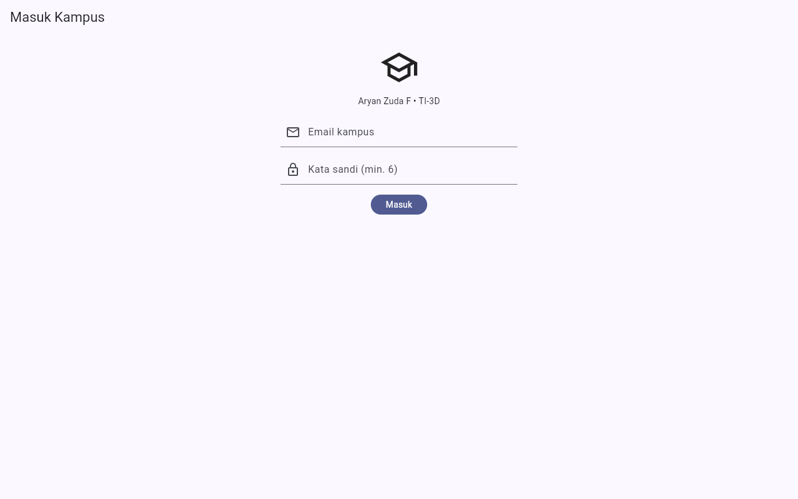
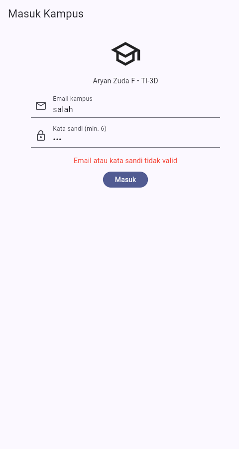
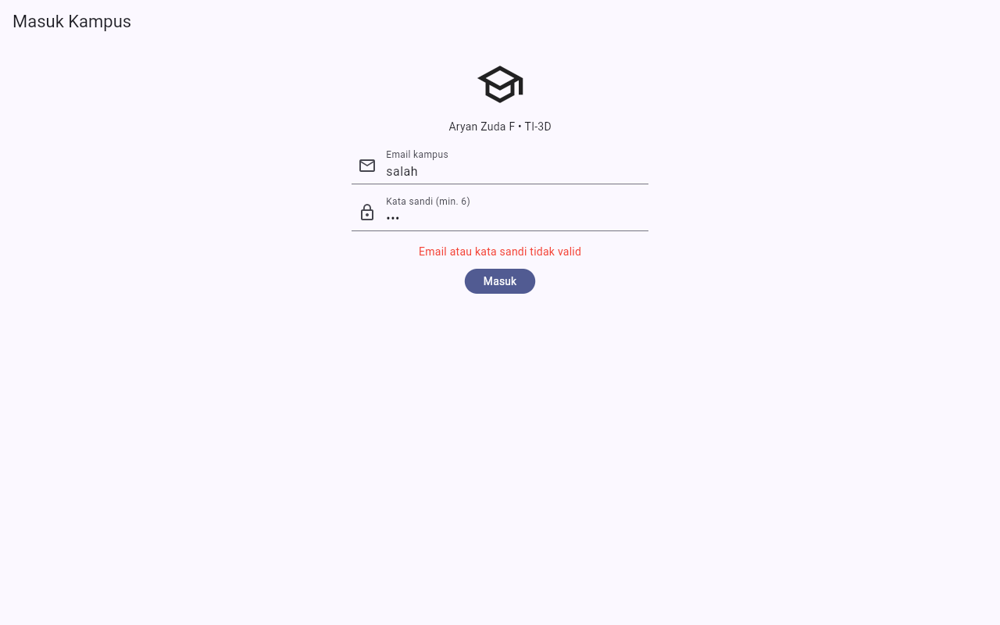
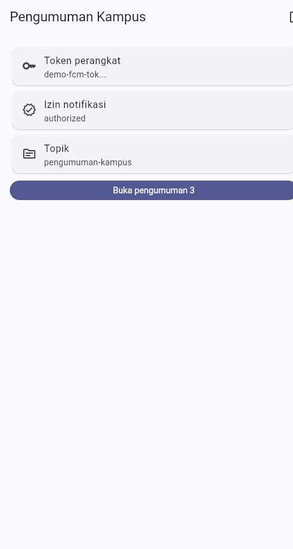
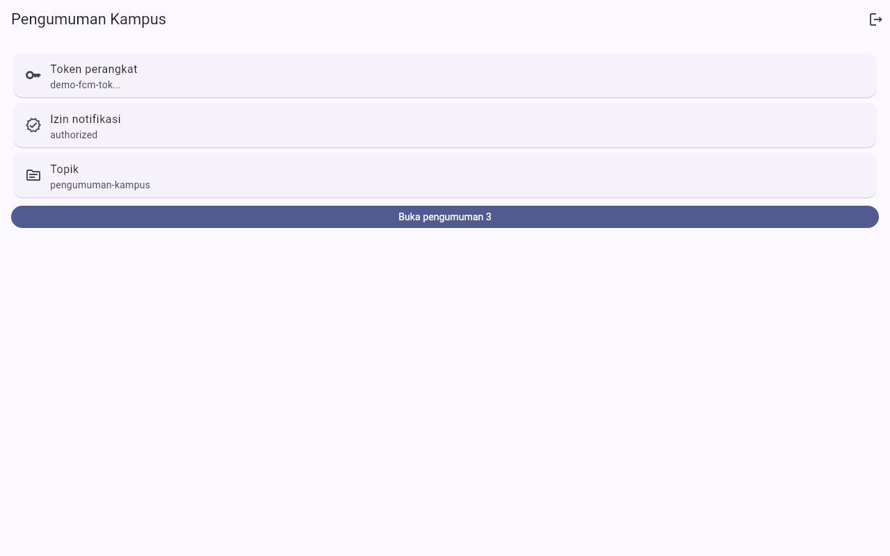
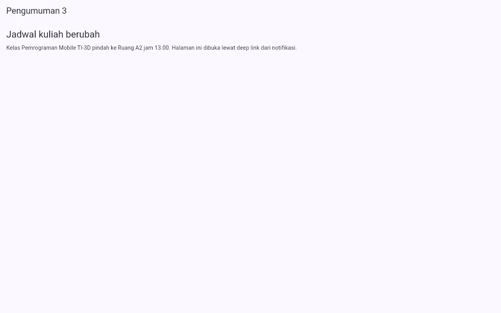
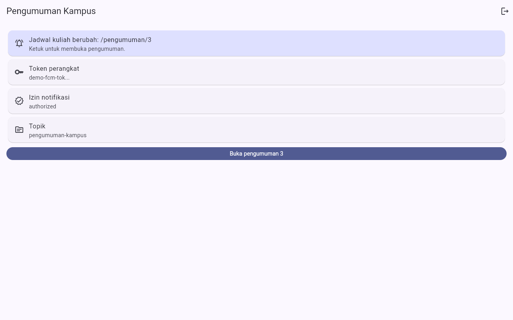
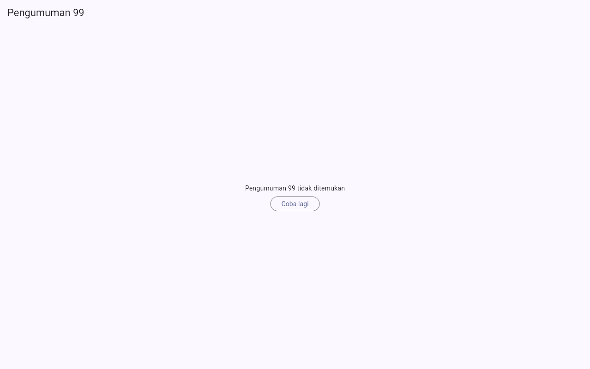
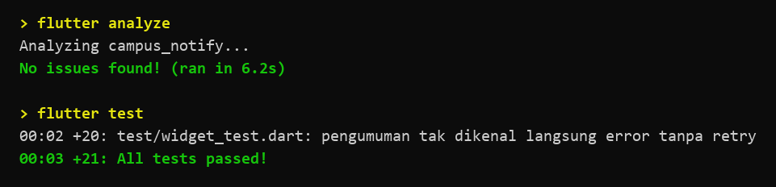

# Minggu 7 — Clean Architecture (Feature-First)

Refactor proyek Minggu 6 `campus_notify` (auth + FCM + pengumuman) ke
struktur **feature-first Clean Architecture**: tiga layer
`presentation/domain/data` per fitur, interface repository di domain,
use case untuk aturan bisnis, wiring DI terpusat di provider Riverpod,
dan `Failure` sebagai satu-satunya bentuk error yang sampai ke UI.

**Aryan Zuda F · NIM 244107020060 · TI-3D**

Snapshot sebelum refactor: commit `39ddcf3` (Minggu 6) — bisa
dibandingkan dan di-rollback.

## Gambaran & aturan dependensi

```text
presentation (widget, notifier, provider wiring)
      |
      v  bergantung ke
domain (entity, repository interface, use case, failure)
      ^
      |  diimplementasikan oleh
data (repository impl, Dio, secure storage, Firebase, model)
      |
      v  boleh memakai
core (failures, format)  ← murni Dart, bebas framework
```

**Aturan emas:** dependensi hanya mengarah ke dalam. `domain` dan
`core` tidak mengimpor Flutter/Dio/SQLite/Firebase sama sekali —
terbukti dengan grep di bawah, bukan sekadar klaim.

## Stack

**Flutter 3.47 (Dart 3.13) · `flutter_riverpod` ^3 · `go_router` ^18 ·
`dio` ^5 · `flutter_secure_storage` ^11 · `firebase_core` ^4 ·
`firebase_messaging` ^16 · `flutter_local_notifications` ^22.**
Tanpa package DI tambahan — Riverpod cukup.

## Isi folder

```text
07-week-7-clean-architecture/
├── campus_notify/              # project Flutter hasil refactor (di-ignore Git)
│   └── lib/
│       ├── main.dart           # composition root: demo ?demo= + GoRouter + wiring
│       ├── routes.dart         # konstanta rute + topik push
│       ├── core/
│       │   ├── failures.dart   # sealed Failure + errorMessage() (murni Dart)
│       │   └── format.dart     # routeFromMessage(), tokenPreview() (murni)
│       └── features/
│           ├── auth/
│           │   ├── domain/  entities/auth_session · repositories/{auth_repository,
│           │   │            session_store} · usecases/login
│           │   ├── data/    auth_repository_mock · session_store_impl ·
│           │   │            api_client (refresh-sekali) · api_errors
│           │   └── presentation/  providers/auth_providers · pages/login_page
│           ├── announcements/
│           │   ├── domain/  entities/announcement · repositories/announcement_repository
│           │   │            · usecases/get_announcement
│           │   ├── data/    announcement_repository_impl (sumber statis)
│           │   └── presentation/  providers/announcements_providers ·
│           │                        pages/announcement_page
│           └── push/
│               ├── domain/  repositories/push_service (kontrak)
│               ├── data/    firebase_push_service (+ handler BG top-level) ·
│               │            fake_push_service
│               └── presentation/  providers/push_providers · pages/home_page
├── lib/                        # salinan kode final (untuk portofolio)
├── test/                       # salinan test final (21 test)
├── docs/ai-challenge.md        # prompt, tabel usulan-vs-keputusan, grep
├── screenshots/                # before (minggu 6) & after (refactor)
└── README.md
```

> Yang bisa dijalankan ada di `campus_notify/` (di-ignore Git).
> `lib/` dan `test/` adalah salinan final untuk portofolio.

## Pemetaan file lama → layer (tabel telaah codelab)

| File | Layer saat ini | Masalah & tindakan |
| --- | --- | --- |
| `pages/home_page.dart` | presentation | dulu menyiapkan state push sendiri → kini hanya baca `pushUiProvider`; logout lewat callback dari composition root |
| `pages/announcement_page.dart` | presentation | dulu konten statis di widget → kini baca `announcementProvider(id)` (loading/error+retry/data) |
| `data/auth_repository.dart` | data (kontrak tercampur) | dipisah: interface di domain, impl `AuthRepositoryMock` di data |
| `data/token_store.dart` | data | kontrak `SessionStore` di domain; `SecureSessionStore`/`MemorySessionStore` di data |
| `messaging/push_service.dart` | campur | kontrak `PushService` (domain), Firebase+Fake (data), `PushUiState` (presentation) |
| `providers/auth_provider.dart` | presentation | tetap tempat wiring; `login` kini lewat use case `Login` |

## Tiga grep verifikasi dependency rule

```text
# 1. Presentation steril dari data mentah (wajib NOL)
rg "Dio\(|openDatabase|getDatabasesPath|FlutterSecureStorage|SharedPreferences\.getInstance|jsonDecode" lib/features/*/presentation
→ 0 hasil

# 2. Domain & core steril dari framework (wajib NOL)
rg "import 'package:flutter|import 'package:dio|import 'package:sqflite|import 'package:firebase" lib/features/*/domain lib/core
→ 0 hasil

# 3. Static analysis + test
flutter analyze → No issues found!
flutter test    → 00:03 +21: All tests passed!
```

## Fitur utama

**Auth** — `Login` use case (validasi kredensial = aturan bisnis) →
`AuthRepository` (interface) → `AuthRepositoryMock` (ganti titik ini
dengan Firebase Auth). Sesi lewat kontrak `SessionStore` (Keychain/
Keystore di produksi, memori untuk demo/test). Interceptor Dio refresh-
sekali memakai record `refresh()` — refresh ditolak → `store.clear()` +
logout, tanpa exception bocor.

**Announcements** — entity `Announcement` + `GetAnnouncement` use case
(id kosong ditolak di domain) + repository in-memory (3 pengumuman).
Halaman menampilkan 4 state `AsyncValue`; id tak dikenal →
`NotFoundFailure` + tombol Coba lagi.

**Push** — kontrak `PushService` dengan dua implementasi
(`FirebasePushService` perangkat / `FakePushService` demo-test).
Handler background top-level + pragma. Banner foreground lewat setter
`onBanner(judul, isi, route)` — tujuan deep link diambil dari payload
(`bannerRoute`), bukan hard-code.

## Kapan use case, kapan repository langsung

| Operasi | Bentuk | Alasan |
| --- | --- | --- |
| Login | **use case** | ada aturan bisnis: validasi email/sandi sebelum repository |
| GetAnnouncement | **use case** | ada aturan bisnis: id kosong/spasi ditolak |
| Logout, refresh token (interceptor) | repository langsung | satu-baris; use case hanya menambah lapisan kosong |
| Push (permission/token/topic) | kontrak service langsung | bukan data bisnis, tapi integrasi platform |

Detail usulan AI vs keputusan final:
[`docs/ai-challenge.md`](docs/ai-challenge.md).

## Perilaku identik (before = Minggu 6, after = refactor)

**Login — sebelum (Minggu 6).**

**Login — sesudah (identik).**


**Login error — sebelum.**

**Login error — sesudah** (pesan sama: “Email atau kata sandi tidak
valid”, kini datang dari `AuthFailure`).


**Beranda — sebelum.**

**Beranda — sesudah** (token `demo-fcm-tok...`, izin, topik sama).


**Deep link pengumuman — sebelum.**

**Deep link pengumuman — sesudah** (judul+isi sama, kini dari
repository).


**Banner foreground — sebelum.**

**Banner foreground — sesudah** (teks banner sama
`Jadwal kuliah berubah: /pengumuman/3`).


**Baru — state error yang sebelumnya tak terjangkau:** pengumuman id
tak dikenal kini tampil `NotFoundFailure` + Coba lagi (bukan konten
statis yang salah).


## Bukti uji

```bash
cd campus_notify
flutter analyze
flutter test
```

```text
Analyzing campus_notify...
No issues found!

00:03 +21: All tests passed!
```

21 test: core format (3) · data auth + interceptor (6) · use case Login
(3) · use case GetAnnouncement (3) · FakePushService (2) · widget (4,
termasuk regresi anti-retry Riverpod 3 — lihat refleksi).
Dua test wajib codelab (use case sukses + failure dengan repository
palsu) ada di `get_announcement_test.dart` dan `login_usecase_test.dart`
— domain diuji murni tanpa SQLite/Dio/Firebase.



## Menjalankan

```bash
cd campus_notify
flutter pub get
flutter run -d web-server --web-port=8080   # mode demo (tanpa Firebase)
```

Query demo web: `?demo=login` (belum login), `?demo=home` (sudah
login), `?demo=banner&banner=1` (banner foreground otomatis),
`?autofail=1` (submit kredensial buruk otomatis),
`?demo=banner&banner=1&route=/pengumuman/99` (banner menuju id tak
dikenal — untuk state error). Catatan: deep link langsung
(`/pengumuman/3`) selalu boot ke beranda karena `initialLocation: home`
(sama di Minggu 6); navigasi ke detail dilakukan in-app lewat klik
banner/tombol.

## Checklist verifikasi mandiri

- [x] Tiga grep sterilitas (presentation & domain) nol hasil.
- [x] Interface di domain, implementasi di data; mapping (bila ada)
      hanya di model — di app ini belum ada model karena sumber data
      masih statis (keputusan terdokumentasi).
- [x] Widget tidak menginstansiasi repository; semua lewat provider.
- [x] Aplikasi berjalan identik sebelum/sesudah refactor (screenshot
      before/after; uji manual login → beranda → banner → pengumuman →
      logout, plus `?demo=`).
- [x] `flutter analyze` bersih dan semua test (21) lulus.
- [x] Prompt, tabel usulan-vs-keputusan, dan hasil grep di `docs/`.

## Refleksi

**Mengapa interface repository di domain, bukan di data?** Karena
domain adalah pemilik kebutuhan (“Saya butuh `login()`”), data hanya
cara memenuhinya. Bila dibalik, domain ikut mengimpor Dio/Firebase —
logika bisnis tidak bisa diuji tanpa jaringan, dan mengganti backend
berarti mengedit domain.

**Kapan use case benar-benar dibutuhkan?** Saat ada aturan bisnis atau
operasi lintas repository (validasi kredensial, id kosong, sync).
CRUD satu-baris cukup repository → notifier: use case yang hanya
meneruskan panggilan adalah lapisan kosong — biayanya bukan kode
sekarang, tapi tambahan lapis yang harus dipahami tiap orang baru.

**Bagian mana yang saya tolak dari usulan AI?** Model
`toMap/fromMap` untuk data statis (kode mati), use case untuk logout/
refresh (over-engineering), dan cross-feature import provider logout
(coupling). Semua terdokumentasi di
[`docs/ai-challenge.md`](docs/ai-challenge.md).

**Pelajaran terbesar: retry otomatis Riverpod 3.** Desain “Failure
dilempar sebagai error state” tampak benar — dan lulus semua unit/widget
test — tetapi di browser, halaman `/pengumuman/99` terjebak spinner:
Riverpod 3 me-retry provider yang melempar hingga 10x (backoff
200 ms → 6,4 dtk, total ±40 dtk) sebelum `AsyncError` tampil. Ditemukan
lewat `ProviderObserver` + `print` sementara di build instrumen
(provider `start→done→dispose` berulang, `mut=null`). Perbaikan:
`retry: (_, _) => null` di `announcementProvider` — failure di sini
deterministik (id tak dikenal pasti gagal), retry hanya membuang waktu;
untuk sumber transient (jaringan) `retry` default tetap dipertahankan.
Dikunci oleh test regresi widget “langsung error tanpa retry”
(`pump()` polos tanpa `settle`, agar timer retry tak ikut maju).
